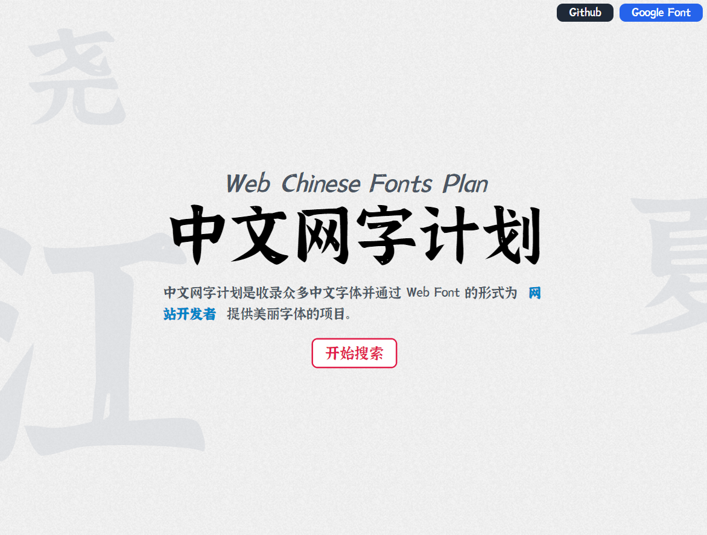

# 中文 Web Font 切割工具 8.0 —— Rust Speed




| [中文网字计划](https://chinese-font.netlify.app/) | [Github](https://github.com/KonghaYao/cn-font-split) | [在线使用](https://chinese-font.netlify.app/zh-cn/online-split/) |
| ------------------------------------------------- | ---------------------------------------------------- | ---------------------------------------------------------------- |

## 简介

`cn-font-split` 是 **[中文网字计划](https://chinese-font.netlify.app/)** 使用的字体分包工具，把大体积字体拆成适合网络分发的小包。它按字体实际包含的字符做智能分包，对中文、日韩文字、少数民族文字与阿拉伯文都有优化。

-   🚀 Rust 原生运行（Node FFI / WASM），秒级完成分包。
-   📦 产物跨平台一致：同一字体、同一配置得到相同的分包与指纹。
-   🔧 支持 TTF / OTF / WOFF2、复杂字形、可变字体与预览图。
-   🚄 前端构建插件：[vite-plugin-font](https://npmjs.com/package/vite-plugin-font)。

    8.0 是 breaking release：指纹算法、错误模型、安装方式与 Node 版本要求都有变化，
    升级前请阅读 **[8.0 迁移指南](./docs/MIGRATION-8.0.md)**。

## 安装

要求 **Node.js >= 22**（pnpm 12）。

```sh
pnpm i cn-font-split
```

主包通过 `optionalDependencies` 自动安装当前平台的二进制包
`@cn-font-split/<platform>`，安装期不再联网下载。自编译或自定义动态库时用
`CN_FONT_SPLIT_BIN` 覆盖（见下）。

## Node 用法

```js
import { fontSplit } from 'cn-font-split';

await fontSplit({
    input: './fonts/NotoSerifSC-Regular.ttf', // 路径或 Uint8Array
    outDir: './dist/font',
    // 可选：chunkSize: 70 * 1024
});
```

常用配置：

| 字段                                     | 说明                          |
| ---------------------------------------- | ----------------------------- |
| `input`                                  | 字体路径或 `Uint8Array`       |
| `outDir`                                 | 产物目录（必填）              |
| `chunkSize`                              | 单包目标字节数，默认 70KB     |
| `subsets`                                | 手动子集 `number[][]`         |
| `css.fontFamily` / `css.fontWeight`      | 生成的 `@font-face` 属性      |
| `renameOutputFont`                       | 输出模板，默认 `[hash].[ext]` |
| `reporter` / `testHtml` / `previewImage` | 报告、测试页、预览图          |
| `silent`                                 | 关闭逐文件日志                |

构建失败时 Promise 会 reject，错误文本来自核心的结构化错误事件；进程不会崩溃。

### 平台二进制覆盖

```sh
CN_FONT_SPLIT_BIN=/abs/path/libffi.dylib cn-font-split -i font.ttf -o dist
```

解析顺序：`CN_FONT_SPLIT_BIN` → `@cn-font-split/<platform>` 平台包 → 仓库内
`packages/ffi-js/dist/libffi-<target>.<ext>`（仅本地开发）。

## CLI

```sh
pnpm i -g cn-font-split
cn-font-split -i ./SmileySans-Oblique.ttf -o ./dist
cn-font-split run -h   # 查看完整参数（与 Node 配置一一对应）
```

## 浏览器 / WASM

平台包 `@cn-font-split/wasm32-wasip1` 提供 WASI 版二进制，在浏览器里用
`memfs` + WASI 运行，产物以 `{ name, data }[]` 返回。

两个 wasm 平台包不随主包传递安装，使用前需显式安装：

```sh
npm i @cn-font-split/wasm32-wasip1   # 或 @cn-font-split/wasm32-wasip2
```

```ts
import { fontSplit, StaticWasm } from 'cn-font-split/dist/wasm/index.mjs';
import wasmBuffer from '@cn-font-split/wasm32-wasip1/libffi-wasm32-wasip1.wasm?url';

const wasm = new StaticWasm(wasmBuffer); // 只需初始化一次

const files = await fontSplit(
    { input: new Uint8Array(fontBuffer), outDir: './dist' },
    wasm.WasiHandle,
    { logger: (str, type) => console[type === 'error' ? 'error' : 'log'](str) },
);

for (const file of files) {
    // 自行写盘 / 上传，例如 file.name、file.data
}
```

> WASM 产物需要在浏览器中提供 `wasi_snapshot_preview1` 与共享内存支持。
> 两个 wasm 平台包（`wasm32-wasip1` / `wasm32-wasip2`）已随 8.0.0 发布；不随主包安装；未做运行时冒烟。

## Rust API

`font_split` 返回 `Result<()>`，失败时先发一个 `EventName::Error` 事件，再返回
`Err(FontSplitError)`：

```rust
use cn_font_proto::api_interface::{EventMessage, EventName, InputTemplate};
use cn_font_split::{font_split, FontSplitError};

let config = InputTemplate {
    input: std::fs::read("font.ttf")?,
    out_dir: Some("./dist".into()),
    ..Default::default()
};

let result = font_split(config, |event: EventMessage| {
    if event.event == EventName::Error as i32 {
        eprintln!("font_split error: {}", event.message);
    }
});

match result {
    Ok(()) => {}
    Err(FontSplitError::InvalidFont(msg)) => eprintln!("字体损坏: {msg}"),
    Err(err) => eprintln!("失败: {err}"),
}
```

`FontSplitError` 的变体见 `src/error.rs`：`EmptyInput`、`InvalidWoff2`、
`InvalidFont`、`InvalidSubsets`、`InvalidConfig`、`Io`、`Internal`。

## 产物与指纹

-   字体文件：`{blake3}.woff2`，指纹为 **blake3，64 位小写十六进制**。
-   `renameOutputFont` 支持 `[hash]`、`[blake3]`、`[index]`、`[ext]` 与
    `[hash:n]`（截断）；`[hash:6]` 的写法与 7.x 相同，但内容已是 blake3。
    `[md5]` 作为历史别名保留，值同样是 blake3。
-   同时输出 `result.css`、可选的 `reporter.bin` / 测试 HTML / 预览图。

## 平台支持

| 平台                | 平台包                            | 状态                                         |
| ------------------- | --------------------------------- | -------------------------------------------- |
| macOS arm64         | `@cn-font-split/darwin-arm64`     | 已发布 8.0.0                                 |
| macOS x64           | `@cn-font-split/darwin-x64`       | 已发布 8.0.0                                 |
| Windows x64 MSVC    | `@cn-font-split/win32-x64-msvc`   | 已发布 8.0.0                                 |
| Windows arm64 MSVC  | `@cn-font-split/win32-arm64-msvc` | 已发布 8.0.0                                 |
| Linux x64 glibc     | `@cn-font-split/linux-x64-gnu`    | 已发布 8.0.0                                 |
| Linux arm64 glibc   | `@cn-font-split/linux-arm64-gnu`  | 已发布 8.0.0                                 |
| WASI preview1       | `@cn-font-split/wasm32-wasip1`    | 已发布 8.0.0（不随主包安装；未做运行时冒烟） |
| WASI preview2       | `@cn-font-split/wasm32-wasip2`    | 已发布 8.0.0（不随主包安装；未做运行时冒烟） |
| Linux riscv64 glibc | —                                 | 仅 artifact（无 npm 包）                     |
| Linux s390x glibc   | —                                 | 仅 artifact（无 npm 包）                     |

musl、BSD、32 位等没有预编译包的平台请设置 `CN_FONT_SPLIT_BIN`。
Bun / Deno 走各自的加载入口，属 best-effort，未纳入 8.0 发布验收。

## 更多文档

-   [8.0 迁移指南](./docs/MIGRATION-8.0.md)
-   [配置说明](./docs/CONFIG.md)
-   [开发者文档](./Developer.md)
-   [8.0 重构计划与交付状态](./docs/REFACTOR-8.0.md)
-   [8.0 npm 发布记录](./docs/RELEASE-8.0-NPM.md)
-   [JavaScript 包文档](./packages/ffi-js/)
-   [OpenType Feature 支持情况](./packages/test/SUPPORT_FEATURE.md)
-   [性能基准结果](./bench-results/)

## 感谢

1. [Harfbuzz](https://github.com/harfbuzz/harfbuzz) 提供专业级字体子集化与绘制能力；本项目使用 Rust 绑定 [harfbuzz_rs_now](https://github.com/KonghaYao/harfbuzz_rs)。
2. [opentype](https://crates.io/crates/opentype) 提供字体信息抽取能力。
3. [Cross](https://crates.io/crates/cross) 提供跨平台构建能力。
4. 感谢 [通义千问](https://tongyi.aliyun.com/qianwen/) 与 GPT-4o 在 Rust 重构阶段提供的帮助。
